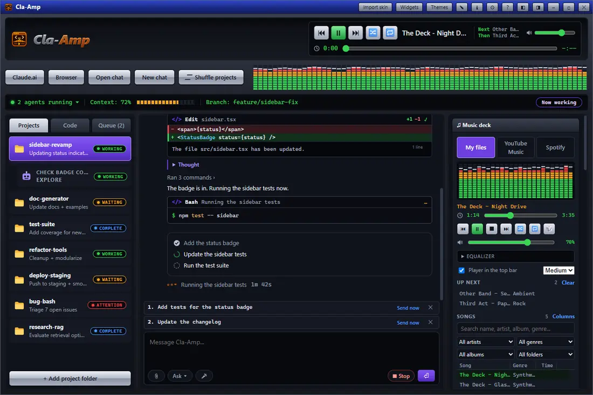
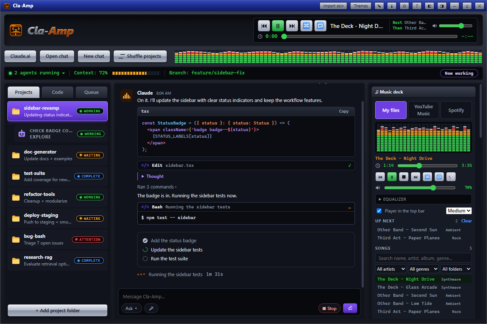

# Cla-Amp

A retro music-player-style workspace that runs Claude Code. You chat with
Claude about the files in a folder while your music plays in the same window.

Cla-Amp is an independent, unofficial project. It is not made, sponsored or
endorsed by Anthropic, by the makers of Winamp, by Spotify, by Google or
YouTube, or by Microsoft. Claude and Claude Code are Anthropic's; Cla-Amp only
runs Claude Code, unchanged, on your computer.



The same window, still (made-up projects and songs):



Windows only for now.

## What it can do

- **Run Claude Code in a window.** Pick a folder; Claude reads and changes the
  files in it as you chat, and asks before it runs a command or changes a
  file unless you choose otherwise.
- **Use the chats you already have.** It works with the same Claude Code and
  the same saved chats as the Claude desktop app and the terminal. Your
  existing chats are listed by folder; click one to carry on with it.
- **Show what is going on.** Agents at work, how full the context is, your
  plan's usage limits, the model and effort in use, a queue for messages sent
  while Claude is busy.
- **Play music.** Your own music files, with a spectrum and an equalizer.
  YouTube Music and Spotify open in your own browser; the deck shows what is
  playing and has play, pause, next and previous, through Windows' own media
  controls.
- **Open claude.ai beside it.** Your regular Claude chats in a browser window
  docked to Cla-Amp.
- **Change its look.** Skins, widgets (clock, calendar, today's
  numbers), movable panels, saved themes, and classic Winamp skins imported
  for their colours.
- **Arrange it your way.** Drag panels and whole sections of the window
  about, hide what you do not use with a right-click, choose what the status
  bar and the song list show, and save the lot as a theme.
- **Made to be reachable.** Everything by keyboard, a size control, a
  Calm setting that stops all movement, a High Contrast skin, and words
  for screen readers.
- **Use it in your language.** The window's own words come in twelve
  languages (machine-translated; English where a piece is missing).
- **Change the program itself by asking.** Cla-Amp is its own source code:
  add its folder as a project and tell Claude what you want changed.

Five minutes to make it yours: [docs/quick-start.md](docs/quick-start.md).
More about each part: [docs/details.md](docs/details.md). How to use it:
[docs/user-guide.md](docs/user-guide.md).

## A word from the author

This project is meant to be purely open: all of the source is public, it is
free, and I have no plans to make money from it, now or later. Use it for
anything you like, your paid work included; the one thing the licence does
not allow is selling Cla-Amp itself. I offer no support;
problems and ideas are welcome on the Issues page, and you are free to fork it
and improve it. The program was written with Claude Code.

## Install it

### The easy way

1. On this page press the green **Code** button, then **Download ZIP**.
2. Unzip it somewhere you will find it again, for example your Documents
   folder. (Right-click the ZIP, **Extract All**.)
3. Open the folder and double-click **Cla-Amp.bat**.

The first time, a black window sets Cla-Amp up: it downloads what Cla-Amp
needs (a few hundred megabytes, some minutes) and then starts it. After that a
double-click starts it at once.

- Cla-Amp needs [Node.js](https://nodejs.org), a free program, for that
  set-up. If it is missing, the black window says so and offers to install it
  or to open its download page. Install it, then double-click
  `Cla-Amp.bat` again.
- Windows may ask whether to run a file that came from the internet. That is
  expected for a downloaded `.bat` file; choose to run it if you trust where
  you got Cla-Amp from.
- There is no installer and the program is not signed.
- Your settings, chats and sign-ins are kept elsewhere on your computer, not
  in this folder.

## Update it

Cla-Amp never updates by itself. When you want the newest version:

1. Close Cla-Amp.
2. Double-click **Update.bat** in the Cla-Amp folder and answer **Y**.

It fetches the newest version from this page and puts it over the folder
(with git if the folder was made with git, else from the ZIP), then fetches
anything new that Cla-Amp needs. Your settings, chats, themes and sign-ins
stay as they are. Files of Cla-Amp that you changed yourself are replaced.

By hand it is the same thing: download the ZIP again and unzip it over the
old folder, or run `git pull` and `npm install` in a folder made with git.

### If you know your way around

You need [Node.js](https://nodejs.org) 20 or newer.

```bash
npm install
```

```bash
npm start
```

`npm run demo` opens the window with made-up projects and no Claude Code
behind it, to look at the layout. It shows nothing of yours (no account,
chats, settings, themes or music) and changes nothing you keep.

## Sign in, and what that involves

The first time, the window shows a short welcome with the steps.

1. **Press Sign in.** A console window opens Claude Code's own sign-in, which
   sends you to Claude's sign-in page in your browser. You sign in there, on
   Anthropic's page.
2. **Pick a folder** for Claude to work in, or open one of your existing
   Claude Code chats from the **Code** tab.
3. **Type a message.**

What signing in involves:

- **You need your own Claude account**, the same as for Claude Code. Cla-Amp
  comes with no account, no key and no usage of its own.
- **Which kind of account.** Claude Code's sign-in offers both an API
  account (Anthropic Console, paid by use) and a Claude subscription. An API
  account is the route Anthropic documents for programs built on its Agent
  SDK, as this one is. Whether a Claude subscription may be used through a
  third-party window like this one has not been confirmed with Anthropic;
  if you use one, that is between you and Anthropic's terms.
- **Cla-Amp never sees your Claude password or sign-in.** The sign-in is
  Claude Code's, and Claude Code keeps it, exactly as it does when you use
  Claude Code by itself.
- **Your use counts against your own plan**, under Anthropic's terms, the same
  as using Claude Code directly.
- **Claude.ai is a separate, optional sign-in.** The Claude.ai button opens
  the claude.ai website in a browser window of its own. You sign in there
  yourself, on Claude's page. The Code chats work without it.
- **Music services are optional too.** YouTube Music and Spotify open in your
  own browser; you sign in there, and Cla-Amp never sees those sign-ins. It
  adds nothing to their pages and reads nothing from them.

## Privacy

- Cla-Amp has no server, no accounts of its own, and no tracking.
- Your chats go to Claude through Claude Code, exactly as they do in Claude
  Code itself.
- Nothing on it can be reached from the network. It adds nothing to your
  browser.
- To draw the spectrum it captures the sound your computer is playing, in
  memory only; nothing is saved or sent.
- Two things go out, each only when you use it: **Import from link** fetches
  the one Winamp skin you pointed it at from the Winamp Skin Museum, and
  **Update.bat** downloads Cla-Amp's newest version from this page.
- It holds no password, key or token for any service.
- It reads the Claude desktop app's list of chats on your computer, to show
  their titles and grouping. It never changes that app's files.

The privacy page: [docs/privacy.md](docs/privacy.md). How it is kept safe,
including known limits: [docs/security.md](docs/security.md).

## Licence

Cla-Amp is free and its source is public, under the
[MIT License with the Commons Clause](LICENSE.md). In short:

- You may use it for anything, at home or at work, including work you are
  paid for and things you make and sell with its help.
- You may change it and share it, as long as the licence text goes with it.
- You may not sell it: no charging for Cla-Amp, for a changed copy of it, or
  for a product or service whose value comes mostly from it, paid hosting
  and paid support included.

The licence text, not this summary, is what counts. Because of that one
limit, the exact term for this is "source-available" rather than "open
source".

The licence covers Cla-Amp's own files only. Every other part keeps its own
licence ([THIRD-PARTY-NOTICES.md](THIRD-PARTY-NOTICES.md)). Claude Code and
the Claude Agent SDK are Anthropic's, not open source, and you use them
under your own agreement with Anthropic. Much of Cla-Amp was written with an
AI coding assistant under the author's direction; how far copyright, and so
this licence, reaches for such code is not settled law.

## Good faith, and how to ask for a change or removal

Cla-Amp is made in good faith to work alongside other people's products, not
to copy or replace them. It rests on these understandings of the author's.
They are the author's reading, not permissions given by those companies:

- **Claude Code.** Cla-Amp runs Anthropic's Claude Code as Anthropic publishes
  it, unchanged. Each person signs in through Claude Code's own sign-in with
  their own account. Nothing is resold, shared or passed through the author.
- **Music and claude.ai.** YouTube Music, Spotify and claude.ai are opened as
  their own pages in the person's own browser. Cla-Amp adds nothing to those
  pages, reads nothing from them and automates nothing on them. What is
  playing comes from Windows' own media controls.
- **Names and looks.** Other products' names appear only in plain text, to say
  what Cla-Amp works with. No logo, picture, sound or other artwork of theirs
  is included; the skins are drawn in code.

If you own or speak for any of these products, or for anything else you find
here, and you want something changed or removed, please open an issue on this
project's Issues page. It will be changed or removed promptly; no formal
notice is needed.

## Credits

- Written with Claude Code, Anthropic's coding assistant. The icon was made
  with ChatGPT's image models.
- Built with Electron, the Claude Agent SDK, marked, DOMPurify and
  highlight.js.
- Winamp skins come from their own authors, by way of the
  [Winamp Skin Museum](https://skins.webamp.org); Cla-Amp includes none.
- The names Claude, Winamp, Spotify, YouTube and Windows belong to their
  owners and are used only to say what Cla-Amp works with.

Every package and its licence: [THIRD-PARTY-NOTICES.md](THIRD-PARTY-NOTICES.md).

## More

- [docs/quick-start.md](docs/quick-start.md): arranging the window, and
  asking Claude to change Cla-Amp itself.
- [docs/user-guide.md](docs/user-guide.md): using Cla-Amp, for people.
- [docs/details.md](docs/details.md): every part of the window.
- [docs/skins.md](docs/skins.md): making a skin.
- [docs/privacy.md](docs/privacy.md): what stays on your computer, what
  leaves it, how to remove it.
- [docs/security.md](docs/security.md): what it protects against, reads,
  writes and sends.
- [docs/code-guide.md](docs/code-guide.md): for people changing the code.
