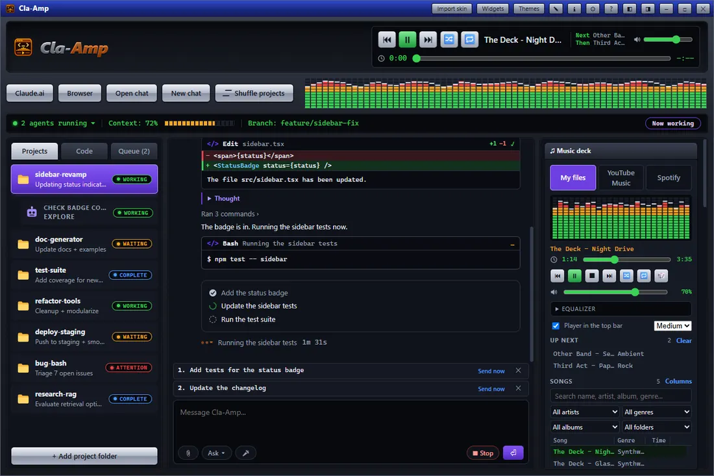

# Quick start: make Cla-Amp yours

Five minutes with the mouse, and the window is laid out the way you like.
Everything here is kept between runs, and a saved theme keeps all of it.

## 1. Move things around

- **Panels.** Drag a panel by its heading to put it somewhere else in its
  column. Click a heading to fold the panel.
- **A second column.** Press **Widgets** in the title bar and tick **A
  second column**, then drag panels into it. Each column has its own
  divider: drag it to make the column wider or narrower.
- **Whole-height columns.** In the same menu, **Side columns run the whole
  height of the window** stands the panels beside the player and the
  buttons instead of under them.
- **Everything else.** **Widgets**, then **Arrange the window...**: the
  logo, the top player, the row of buttons, the spectrum and every panel
  can be dragged to any outlined area. **Done** ends it; **Put everything
  back** undoes it.
- **Sides.** Under **Layout** in the Widgets menu: projects on the left or
  the right, panels on the right or the left, the status bar above the chat
  or along the bottom, the size of the top spectrum, and the typeface.

## 2. Hide what you do not use

- Right-click a panel, or a part of the status bar, and pick **Hide**.
- Bring anything back by ticking it under **Widgets**.
- The status bar is made of parts: agents running, context, branch, model,
  effort, usage limits, date, time and the chat's status. Tick the ones you
  want. Click the model or the effort in the bar to change it.
- For a plain window: hide the panels you do not need, put the status bar
  at the bottom, and keep only the parts you read.

## 3. Set up the song list

- **Columns** (beside **Songs**) ticks what each song's row shows.
- Drag a column's name onto another to move it. Drag the line at a
  column's right edge to size it. Click a name to sort by it.
- **Import playlist** keeps a playlist in the app until you take it out.

## 4. Keep it

Press **Themes** in the title bar and save your set-up under a name. A
theme holds the skin, your colours and the whole arrangement. **Export**
makes a file you can give to someone else; **Import** takes one in.

## 5. Ask Claude to change it for you

Cla-Amp is its own source code, in the folder you unzipped, and Claude Code
can change it. For anything the menus do not offer:

1. Press **+ Add project folder** and pick the Cla-Amp folder itself (the
   one with `Cla-Amp.bat` in it).
2. Start a chat and say what you want, in plain words. For example: "Read
   docs/code-guide.md first. Then add a button to the button row that opens
   my notes folder", or "make the chat text larger", or "add a widget that
   counts down to Friday".
3. Claude changes the files. A chip appears in the title bar: **Reload to
   update** for a change to the window, **Restart to update** for a deeper
   one. Press it to see the change.

Good to know:

- The changes are in your copy only. Keep a copy of the folder before a
  large change, so you can go back.
- **Update.bat** replaces Cla-Amp's files with the official ones, so it
  also replaces your own changes. If you change Cla-Amp a lot, keep your
  copy with git and bring updates in with `git pull`.
- A restart ends whatever Claude was doing in every chat. Let it finish
  first.
- `docs/code-guide.md` says where each part of the program lives, and
  `docs/skins.md` how to make a skin. Telling Claude to read them first
  saves time.

## 6. Get the newest version

Close Cla-Amp and double-click **Update.bat** in the Cla-Amp folder. It
fetches the newest version from the project's page on GitHub and puts it
over this folder: with git if the folder was made with git, else from the
ZIP. Your settings, chats, themes and sign-ins are kept elsewhere on your
computer and stay as they are. Nothing updates by itself; it happens only
when you run it.
